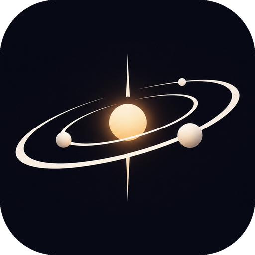

# Orrery

**An interactive 3D solar system for exploration and gravity experiments.**


-555)


[](https://github.com/Ablebil/orrery/actions/workflows/ci.yml)
[](https://github.com/Ablebil/orrery/releases/latest)

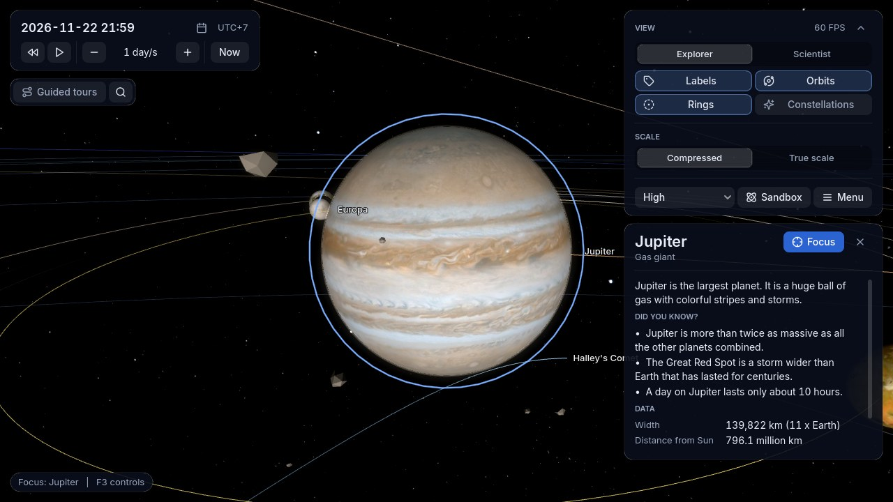

Orrery models the Sun, the eight planets, the Moon, the Galilean moons, Titan, Ceres, Pluto, and the main asteroid belt in real time. Explore the system at any date and speed, follow narrated tours, test what you learned with quizzes, or switch to the Sandbox and build your own gravitational systems with a live N-body simulation. Every piece of content is bundled, so the application runs as a single offline executable.

It is aimed at learners from elementary school to university. Every panel switches between two depth levels: **Explorer** for plain language and **Scientist** for full numeric data.

## Contents

- [Features](#features)
- [Screenshots](#screenshots)
- [Getting started](#getting-started)
- [Controls](#controls)
- [Project structure](#project-structure)
- [Technical overview](#technical-overview)
- [Tests](#tests)
- [Offline tooling](#offline-tooling)
- [Credits](#credits)
- [License](#license)

## Features

### Explore

- **Bodies.** The Sun, 8 planets, 6 moons, 2 dwarf planets, Halley's Comet, and an instanced asteroid belt of up to 10,000 rocks.
- **Comet tails.** Near the Sun, Halley's Comet grows a blue ion tail that points straight away from the Sun and a broader dust tail that curves back along its orbit, both drawn with GPU particles. Its orbit uses the JPL solution for each return, so the 1835, 1910, and 1986 perihelia fall on their real dates, and its nucleus is stretched to its 15 by 8 km shape.
- **Real night sky.** 8,920 naked-eye stars from the HYG catalog, sized by brightness and colored by temperature, with optional constellation figures and names. The Milky Way panorama is aligned to the real sky.
- **Accurate orbits.**
  - Planets use JPL Keplerian elements.
  - The Moon uses the main terms of Meeus' lunar theory, so eclipses happen within 2 minutes of their real times.
  - The Galilean moons use JPL satellite mean elements.
  - Ceres and Pluto use JPL Small-Body Database orbits.
  - Positions of the moons and dwarf planets agree with JPL Horizons to within 0.4°.
- **Time control.** Play, pause, reverse, change the speed, or jump to the current date. Dates are shown in the computer's time zone, such as UTC+7.
- **Date jump.** Go to any date and time from 1800 to 2050, or to a historic moment such as the Apollo 11 landing, Halley's Comet in 1986, or the 2027 total solar eclipse.
- **Eclipse finder.** Jump to the previous or next solar or lunar eclipse. The view switches to true scale and frames the shadow at the moment of greatest eclipse, within 2 minutes of NASA's times.
- **Body search.** Type part of a name to find any body and fly to it.
- **Two scales.** A compressed view keeps every world visible. True scale shows real sizes and distances.
- **Eclipses.** Moons cast shadows on their planets and planets on their moons, such as Io's shadow crossing Jupiter or the red Moon of a lunar eclipse, with a soft penumbra from the size of the Sun's disk.
- **Body information.** Click any body for a summary, facts, and live orbital data at either depth level.
- **Guided tours.** Five tours: Grand Tour, Earth and Moon, Sense of Scale, Moons and Dwarf Planets, and Eclipses and Comets. Each has captions and synthesized voice-over for both levels, and tour stops can jump to a date, such as an eclipse or Halley's 1986 return.
- **Quizzes.** Every tour has a short quiz for each level, with an explanation after each answer. The quiz is offered when a tour ends and can be opened from the tour menu.
- **Introduction.** The first visit shows eight short tips that point out each part of the interface, including the eclipse finder and the Sandbox. They can be shown again from Settings.

### Sandbox

- **Gravity simulation.** Mutual N-body gravity uses Velocity Verlet or RK4, with adaptive or fixed time steps and a per-frame CPU budget. Moon systems are sub-stepped, so the full solar system with every moon runs at about 150 days per second.
- **Build systems.**
  - Place a body and drag to launch it.
  - Edit a body's mass, radius, and color, freeze it, or remove it.
- **Collisions.** Bodies that touch merge with conserved mass and momentum. A swept contact test stops fast bodies from passing through each other.
- **Presets.** Solar system with Halley's Comet and its tails, binary star, extra planet, rogue star flyby, and the figure-eight orbit of three equal stars. Stars without a parent draw their trails around the system's barycenter. Snapshots save the current state and restore it later.
- **Gravity well.** A grid under the bodies bends by their gravitational potential, so heavier bodies dig deeper wells.
- **Challenges.** Five missions with automatic checks: put a planet in orbit, stretch the orbit into an ellipse, escape the star, give a giant planet a moon, and gain energy from a gravity assist.
- **Conservation readouts.** At the Scientist level, total energy and angular momentum are shown with their drift, to illustrate the numerical error of each integrator.

### Application

- **Menus.** A main menu, a pause menu, a credits screen, and settings that persist between sessions.
- **Languages.** English and Bahasa Indonesia for the interface, body information, tours, quizzes, and presets, with matching number formats. The first launch follows the system language. The voice-over is English only, so it is turned off in Bahasa Indonesia while captions stay on.
- **Display and graphics settings.**
  - Window mode and resolution.
  - Low, Medium, or High quality preset, plus a render scale slider. High uses 4K textures for the Sun, the major planets, the Moon, and the sky.
  - Orbit trail length.
- **Audio settings.** Separate volumes for music, effects, and narration, a music mute, and a voice-over toggle.
- **Mouse and touchpad.** Drag or swipe with two fingers to orbit the focused body, and pinch or use the mouse wheel to zoom. In free flight, a two-finger swipe moves the camera. Touchpad scrolling is detected automatically, and the scroll behavior can be set to Auto, Orbit, Zoom, or Move.
- **Presentation tools.** Fullscreen toggle, clean screenshots without the interface (saved to `screenshots/` in the user data folder), a performance overlay with frame time and draw calls, and a cinematic auto-orbit that also starts after 20 seconds without input while a body is focused.
- **Controls.** Every action can be rebound. Conflicting bindings are refused, and the grouped controls help (F3) follows the active keys.
- **Troubleshooting.** Settings → Controls opens the log folder for bug reports and resets every setting after a confirming second press, keeping completed challenges.
- **Accessibility.**
  - Interface size of 100%, 115%, or 130%, and a view panel that collapses to make room for body information.
  - Text and controls meet WCAG AA contrast, and keyboard focus is always visible.
  - The whole interface can be used from the keyboard: F6 moves focus into it, Tab moves between controls, and Esc returns to the scene.
  - A colorblind-safe orbit palette (Okabe–Ito).
  - Captions are always shown for narration, and nothing flashes.

## Screenshots

| | |
|---|---|
| 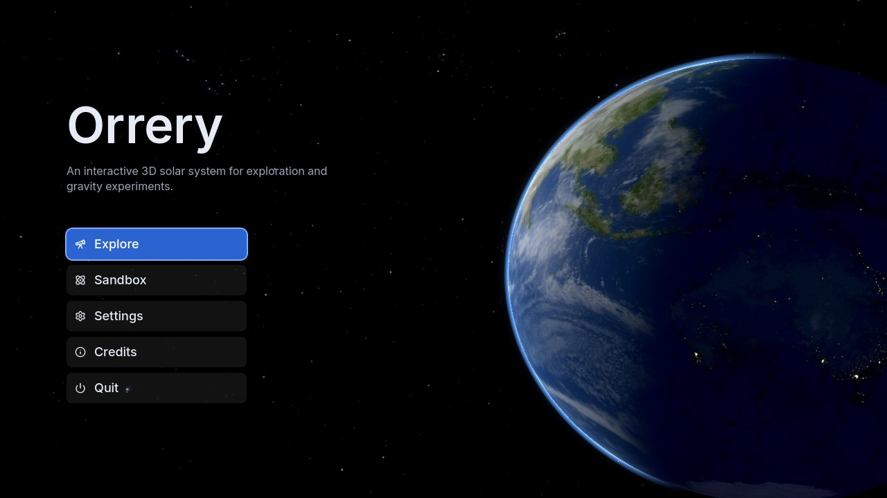 | 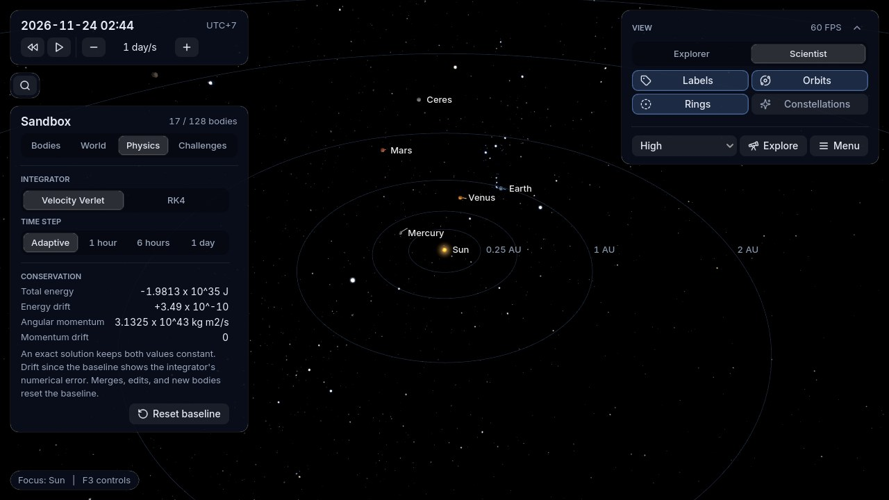 |
| Main menu | Sandbox physics panel with conservation readouts |
| 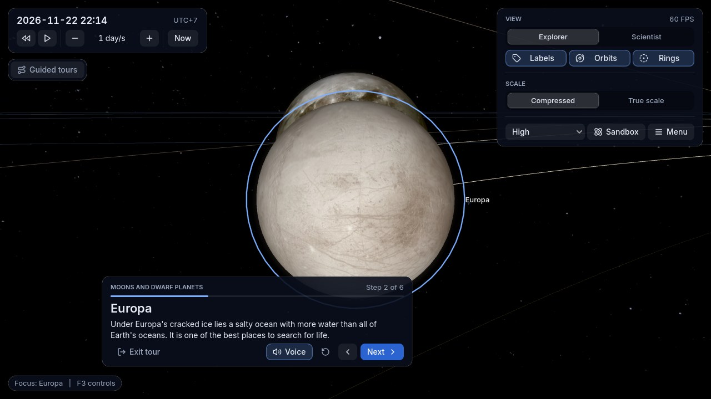 | 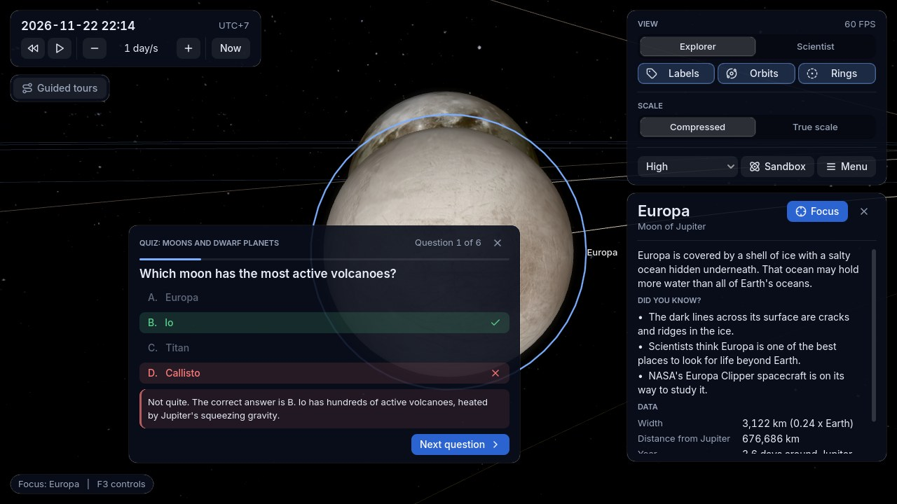 |
| The Eclipses and Comets tour at the lunar eclipse of March 2026 | Quiz feedback with explanations |
| 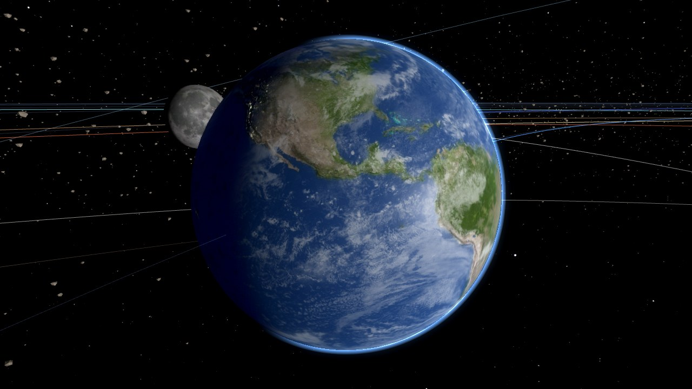 | 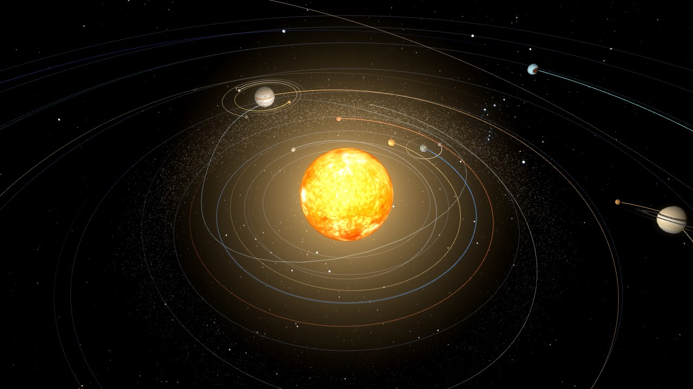 |
| Earth with city lights, clouds, and atmosphere | Inner solar system with the instanced asteroid belt |
| 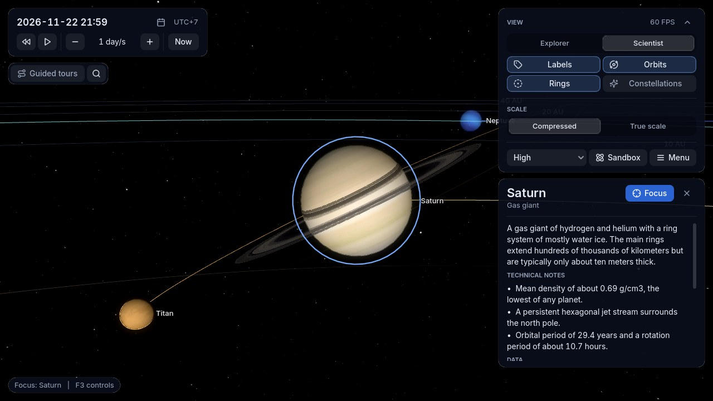 | 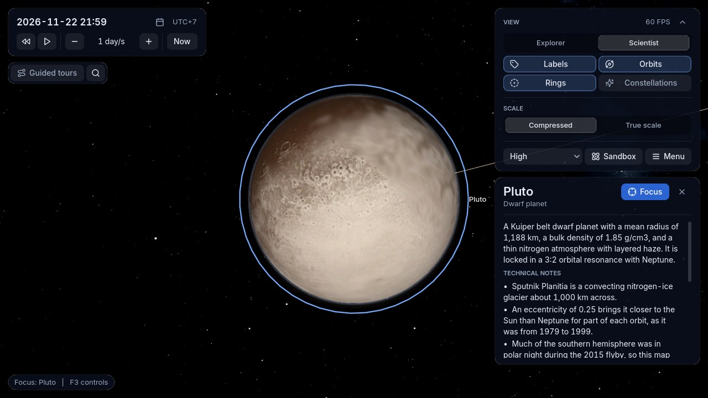 |
| Saturn's rings and the orbit of Titan | Pluto from New Horizons mosaics |
| 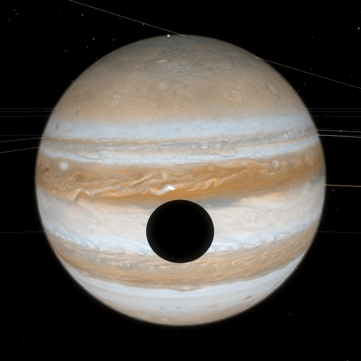 | 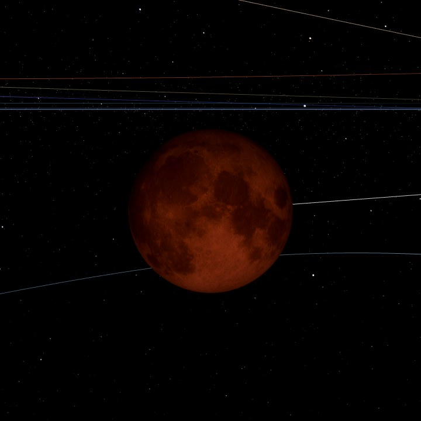 |
| Io's shadow crossing Jupiter | The lunar eclipse of 3 March 2026 at true scale |
| 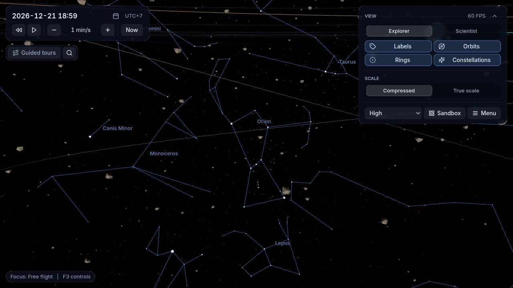 | 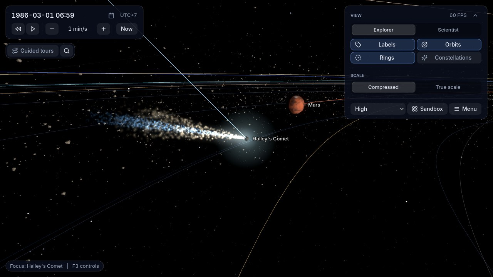 |
| Orion and its neighbors with constellation figures and names | Halley's Comet in March 1986 with its ion and dust tails |
| 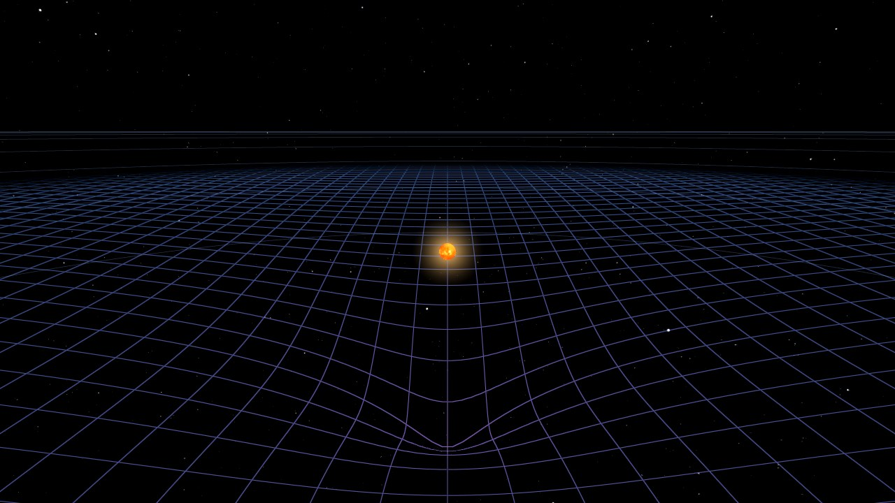 | 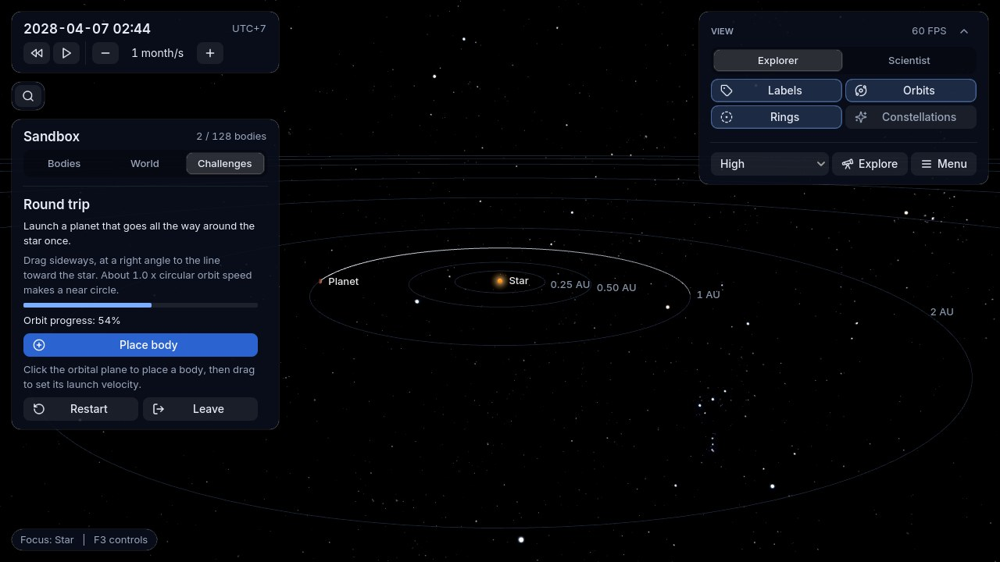 |
| The gravity well under a binary star | A Sandbox challenge in progress |
| 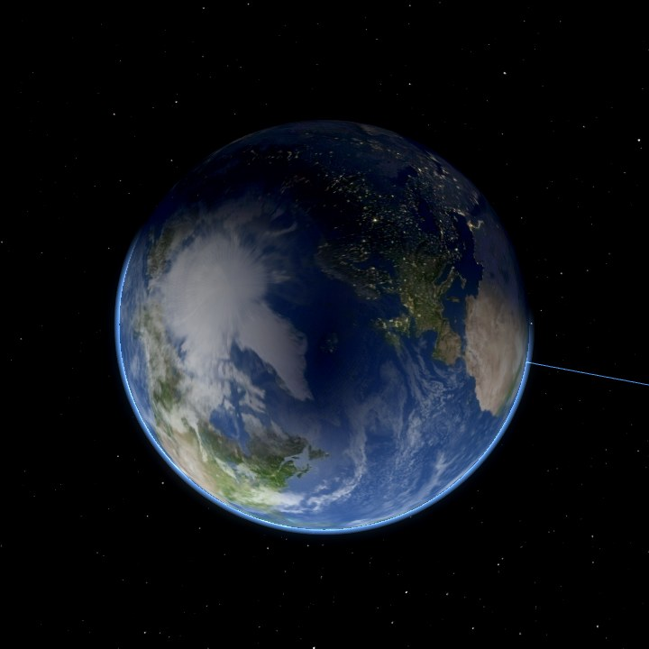 | 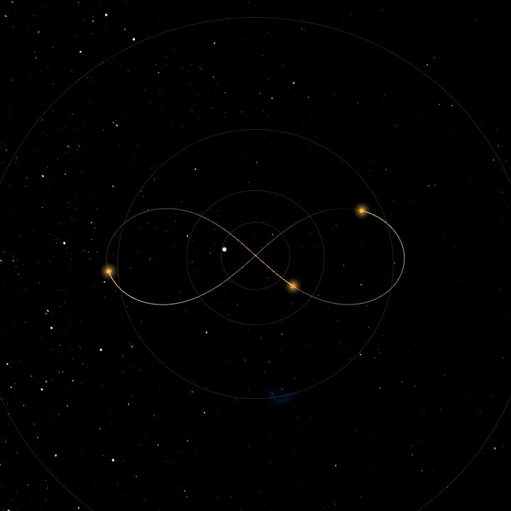 |
| The Moon's shadow over Egypt and the Red Sea, 2 August 2027 | Three stars on the figure-eight orbit |

## Getting started

### System requirements

| Tier | Specification | Target |
|---|---|---|
| Minimum | 64-bit dual-core CPU, 4 GB RAM, integrated GPU with OpenGL 3.3, 1280 × 720 | 30 FPS on Low |
| Recommended | Laptop from the last 5 years with integrated graphics, 8 GB RAM, 1920 × 1080 | 60 FPS on Medium |
| High | Dedicated GPU | 60 FPS on High |

Supported platforms are Windows 10 and 11, and 64-bit Linux. No installation or internet connection is needed.

On Linux, the release archive also contains `install.sh`, which adds Orrery to the application menu of any desktop environment and creates an `orrery` command:

```
./install.sh               # for the current user, no root needed
sudo ./install.sh --system # for every user, into /opt/orrery
./install.sh --uninstall   # remove it again (add --system for a system install)
```

### Run from source

1. Install [Godot 4.7.2](https://godotengine.org/download/archive/4.7.2-stable/) (standard build).
2. Open `godot/project.godot` in the editor and press F5, or run this from the repository root:

   ```
   godot --path godot
   ```

### Export builds

Install the Godot 4.7.2 export templates, then run `./build.sh` (or `./build.sh --install-templates` to fetch them automatically). Set `GODOT` when Godot is not on PATH; on Windows, run it from Git Bash:

```
GODOT=/d/Godot/Godot_v4.7.2-stable_win64_console.exe ./build.sh windows
```

The script finds the templates of a self-contained Godot folder as well as the standard locations on Windows, macOS, and Linux, and `GODOT_TEMPLATES` overrides them. To export without the script, run from the repository root:

```
godot --headless --path godot --export-release "Windows" ../builds/windows/Orrery.exe
godot --headless --path godot --export-release "Linux" ../builds/linux/Orrery.x86_64
```

Each build is a single executable with the game data embedded. On Linux, mark it executable with `chmod +x Orrery.x86_64`.

## Controls

These are the default bindings. Every keyboard action can be rebound in **Settings → Controls**, and **F3** shows the current keys in the application.

| Action | Keys |
|---|---|
| Move, down / up | W A S D, Q / E, or two-finger swipe in free flight |
| Orbit the focused body | Left drag, or two-finger swipe on a touchpad |
| Zoom | Mouse wheel, pinch, or Ctrl + scroll |
| Look around | Right mouse button + move |
| Flight speed / boost | Shift + scroll / Shift |
| Select body / focus body | Left click / double click or 1 – 0 |
| Next body / free flight | Tab / F |
| Pause, reverse, slower / faster | Space or P, R, `[` / `]` |
| Labels, orbit lines, distance rings | L, O, G |
| Constellation figures, gravity well | C, V (Sandbox) |
| Explorer / Scientist level | M |
| Compressed / true scale, jump to now | T, N (Explore) |
| Find a body, go to a date | `/`, J (Explore) |
| Move focus into the interface, then between controls | F6, then Tab / Shift + Tab, Enter or Space, Esc |
| Tour and quiz: previous / next | Left / Right or Enter |
| Remove selected body | Delete or Backspace (Sandbox) |
| Open Explore / Sandbox | F1 / F2 |
| Controls help, hide interface | F3, H |
| Performance overlay, cinematic auto-orbit | F4, F9 |
| Toggle fullscreen, clean screenshot | F11, F12 |
| Cancel, then pause menu | Esc |

## Project structure

```
orrery/
├── .github/                Workflows for tests and releases, the setup-godot action, and README media
├── assets/LICENSES.md      Register of every third-party asset and data source
├── docs/PRD.md             Product requirements document
├── godot/                  Godot project
│   ├── core/               Simulation, data catalogs, settings, input, audio (double precision)
│   ├── data/               Bodies, info texts, tours, quizzes, presets, credits (JSON)
│   ├── modes/              Main menu, Explore, Sandbox, shared scene base
│   ├── render/             Renderers, camera, trails, asteroid belt, shaders
│   ├── ui/                 Theme, HUD, panels, menus, search, date jump, introduction
│   ├── i18n/               Message template and the Bahasa Indonesia catalog
│   └── assets/             Textures, music, effects, narration
├── tests/                  Automated UI, input, and rendering tests with a runner script
├── tools/                  Offline generators for narration, audio, textures, branding, and the star catalog, and the translation extractor
├── build.sh                Release export helper (Linux / Windows)
├── run.sh                  Linux launcher script
└── LICENSE                 MIT license for the project source
```

## Technical overview

| Area | Approach |
|---|---|
| Precision | Simulation state in double precision. Rendering uses a floating origin, and distant objects are drawn on a depth shell to keep the near and far planes usable at solar system scale |
| Orbits | Analytic Kepler propagation in Explore. Satellite elements are rotated from their Laplace or equator plane into the ecliptic |
| Orientation | IAU pole and prime-meridian models for every body |
| N-body | Velocity Verlet and RK4 with Plummer softening, an adaptive dynamical time step, multiple time stepping (r-RESPA) for moon systems, swept collision detection, and Hill-sphere parent tracking |
| Shaders | Day and night surfaces with ocean specular, normal maps from LOLA, MOLA, and ETOPO5 elevation, relief bump mapping, Saturn ring shadow, and eclipse shadows with umbra and penumbra; Sun surface and halo; atmosphere scattering; clouds; rings with planet shadow; GPU-solved Keplerian asteroids; a galactic sky; and a gravity well displaced in the vertex shader |
| Graphics techniques | GPU instancing, GPU particle comet tails, point-sprite stars, dynamic trail meshes, HDR glow, a panoramic sky, screen-space-error level of detail for spheres, mipmapped VRAM-compressed textures at 1K, 2K, or 4K by preset, and quality tiers |
| Audio | Separate Music, Effects, and Narration buses. Music ducks while narration plays |

## Tests

The `tests/` folder holds 301 automated checks for input, camera controls, menus, settings reset, keyboard navigation of the newer panels, the sandbox panel, quizzes, key bindings, accessibility, sandbox accuracy and speed, eclipses and the eclipse finder, the star field, the gravity well, the comet, the challenges, level of detail, texture tiers, the time zone display, search, date jumps, the introduction, keyboard navigation, and the Indonesian interface. They drive the real application, so they need a display and open a window. From the repository root:

```
GODOT=/path/to/godot tests/run_tests.sh              # every test
GODOT=/path/to/godot tests/run_tests.sh pointer_test # one test
```

On Windows, run the script from Git Bash and point `GODOT` at the console executable. Your saved settings and sandbox snapshot are backed up before the run and restored afterwards.

## Continuous integration and releases

Two GitHub Actions workflows keep `main` working and publish builds:

| Workflow | Trigger | What it does |
|---|---|---|
| [CI](.github/workflows/ci.yml) | Every push to `dev` and every pull request into `main` | Checks that every message is translated and the catalogs are current, then imports the project and runs the whole test suite on Ubuntu with a virtual display and software OpenGL. Screenshots of failed checks are kept as a run artifact |
| [Release](.github/workflows/release.yml) | Pushing a tag such as `v1.1.0`, or a manual run from the Actions tab | Checks the tag against the project version, exports the Windows and Linux builds, opens the menu, Explore, and Sandbox in the Linux build as a smoke test, packages them, and publishes a GitHub release. A manual run only keeps the packages as a downloadable artifact for 7 days |

`main` only accepts pull requests whose CI run has passed. To release a new version:

```
tools/release.sh bump 1.1.0   # on dev: sets the version in the project and the Windows metadata, then commits
git push origin dev           # then open a pull request into main and merge it once CI passes
git checkout main && git pull
tools/release.sh tag 1.1.0    # tags v1.1.0 and, after you confirm, pushes the tag
```

`tools/package_release.sh <version>` builds the same archives locally from the output of `build.sh`.

## Offline tooling

All generated assets are committed, so these tools are only needed to regenerate them. Each tool has its own README. The asset generators run with [uv](https://docs.astral.sh/uv/), and the translation extractor needs only Python.

| Tool | Output |
|---|---|
| [`tools/i18n`](tools/i18n) | The message template and translation catalogs in `godot/i18n`, with a check for missing translations |
| [`tools/tts`](tools/tts) | Tour and welcome narration with Kokoro-82M, voice `af_bella` |
| [`tools/audio`](tools/audio) | Procedural background music and sound effects with fixed seeds |
| [`tools/textures`](tools/textures) | Moon and dwarf planet textures from USGS global mosaics, and the 4K High preset textures |
| [`tools/branding`](tools/branding) | Application icon and boot splash from the Orrery emblem |
| [`tools/media`](tools/media) | Every README screenshot, captured from the running application |
| [`tools/stars`](tools/stars) | Naked-eye star catalog and constellation figures from HYG and Stellarium |

## Credits

- **Textures.**
  - Planets, the Sun, the Moon, the rings, and the sky: [Solar System Scope](https://www.solarsystemscope.com/textures/), CC BY 4.0.
  - Moons and dwarf planets: USGS Astrogeology and NASA mission mosaics, public domain.
  - Elevation for normal maps: NASA LRO LOLA, NASA MGS MOLA, and NOAA ETOPO5, public domain.
- **Orbital and physical data.** NASA JPL Solar System Dynamics, the IAU WGCCRE, and Meeus.
- **Stars and constellations.** The [HYG Database](https://github.com/astronexus/HYG-Database) v4.1 by David Nash and the [Stellarium](https://stellarium.org) modern sky culture, both CC BY-SA 4.0. The derived `godot/data/stars.json` is shared under the same license.
- **Narration.** Synthesized offline with Kokoro-82M (Apache-2.0) through kokoro-onnx (MIT). No speech is synthesized at runtime.
- **Music and sound effects.** Generated procedurally with `tools/audio`.
- **Typeface and icons.** [Inter](https://github.com/rsms/inter), SIL Open Font License 1.1, and [Lucide](https://lucide.dev) icons, ISC.
- **Engine.** [Godot Engine](https://godotengine.org/license), MIT.

Every asset is recorded with its source, author, and license in [`assets/LICENSES.md`](assets/LICENSES.md), and listed on the in-app credits screen.

## License

The source code and the generated music, sound effects, and quiz and tour content are released under the [MIT License](LICENSE). Third-party textures, data, and narration keep their own licenses, listed in [`assets/LICENSES.md`](assets/LICENSES.md). In particular, the Solar System Scope textures (CC BY 4.0) require attribution when redistributed, and `godot/data/stars.json`, derived from the HYG Database and Stellarium, is shared under CC BY-SA 4.0.
